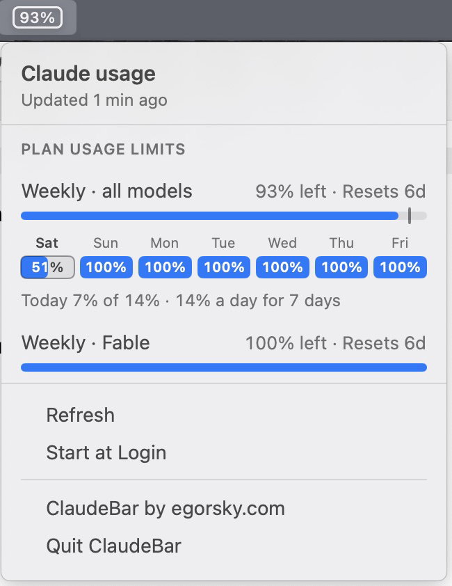

# ClaudeBar

A macOS menu bar app that shows how much of your Claude plan usage limits is left (weekly, per model, 5-hour) and whether you are spending too fast. It warns before the weekly limit runs out ahead of the reset.

Made by [egorsky.com](https://egorsky.com). MIT License.



## Menu bar

A rounded rect with the weekly % left inside. Its color shows how early the limit runs out at the current pace:

| Look | Meaning |
|------|---------|
| Outline, system color | lasts until the reset |
| Yellow | runs out up to 1 day before the reset |
| Orange | more than 1 day before |
| Red | more than 2 days before, or under 10% left |
| `–` | no data yet |

The worse of the weekly and the 5-hour window wins; for the 5-hour window the same rule applies in proportion (1 day of 7 = 43 min of 5 h). There is no forecast until spending is more than 2 pp ahead of an even pace, and the rate is taken over at least one day of the window (43 min for the 5-hour one): 4% in the first 3 hours after a reset is not a weekly rate.

## Panel

Click the badge:

```
Claude usage                         ● Ahead of pace   (only when running out early)
Updated just now
────────────────────────────────────────────
PLAN USAGE LIMITS
Weekly · all models         62% left · Resets 3d
[██████████████░░░░░|░░░░░░░░░]                  tick = even pace
 Sat    Sun    Mon    Tue    Wed    Thu    Fri
[ 0% ] [37% ] [ 0% ] [79% ] [100%] [100%] [100%]  day's budget left, as fill and number
Runs out Fri 18:20 at this pace                   (only when it does)
Today 3% of 14% · 15% a day for 4 days
Weekly · Fable             100% left · Resets 3d
[████████████████████████]
5-hour session              76% left · Resets 2h
[██████████████████░░░░░░]
────────────────────────────────────────────
Refresh
✓ Start at Login
ClaudeBar by egorsky.com
Quit ClaudeBar
```

Bars show what is left and empty from the right. The tick on the weekly bar marks what would be left at an even pace: a fill shorter than the tick means you are ahead of pace.

### Days

The week is split into 7 days of 24 hours counted from the reset time (a reset at 14:00 means days run from 14:00 to 14:00), so every day has the same budget: 100/7 ≈ 14% of the week. Like the bars, a cell shows what is left: it starts full and empties from the right as that day's spend grows. Future days are full. Over budget, the cell is empty on an orange background; over twice the budget, red. The number inside a cell is the % of that day's budget left; today is outlined; `–` means there is no data for that day. Hover a cell for that day's spend.

The usage API reports only the current percentage, so every fetch appends `{at, used, resets_at}` to `~/.config/claudebar/history.jsonl` (kept for 8 days). A day's spend is the difference between the last samples at its start and at its end. Nothing is sampled while the Mac is off; that spend lands on the day the Mac is back.

## How it works

```
usage API (api.anthropic.com) ─┐
                               ├→ claudebar-cli json → ClaudeBar → menu bar
Claude Code status line ───────┘
```

Two sources; the freshest wins:

1. **Usage API**: the endpoint Claude Code itself calls (`api.anthropic.com/api/oauth/usage`). It returns weekly, per-model and 5-hour limits, including usage from claude.ai. It is asked at most every 2 minutes, in the background. The token is Claude Code's OAuth token, from `.credentials.json` in the Claude config dirs (Claude Code on Linux) or the macOS Keychain (Claude Code on the Mac). It is only read, never refreshed: refreshing rotates the refresh token and would log Claude Code out, so an expired token waits until Claude Code renews it.
2. **Status line**: the `rate_limits` field that Claude Code passes to the status line command after each reply. No token involved.

| Part | What it does |
|------|--------------|
| `ClaudeBar` (SwiftUI, `app/ClaudeBar.swift`) | runs `claudebar-cli json` every 20 s and when the panel opens; draws the badge and the panel. Rendering only |
| `claudebar-cli json` (Go) | pace, forecast, daily budget, levels, days: everything the app shows. Starts `claudebar-cli fetch` in the background when the API result is older than 2 min |
| `claudebar-cli fetch` (Go) | one usage API request. Result in `~/.config/claudebar/usage.json`, error in `usage-error.txt`, a weekly sample appended to `history.jsonl` |
| `claudebar-cli statusline` (Go) | status line command: keeps only `rate_limits`, writes `~/.claude/claudebar.json` (mode 600). Prints a line only when a limit runs out before its reset (`week 25% left · runs out Thu 02:00 · slow down`), otherwise nothing |

All math is in Go and covered by tests. Both binaries live in `ClaudeBar.app/Contents/MacOS/`.

## Security

| Check | Result |
|-------|--------|
| Claude Code token | read from `.credentials.json` or the Keychain; sent only to `api.anthropic.com` (the one URL in the code, `UsageURL` in `usage.go`); never written anywhere, never refreshed, never printed in errors |
| Network | one request every 2 minutes or less to `api.anthropic.com`. No analytics, no update checks, no other hosts. The Swift app makes no requests |
| Files it writes | `~/.claude/claudebar.json`, `~/.config/claudebar/usage.json`, `history.jsonl`: percentages, reset times, model names, timestamps. No token. Paths, session text and `transcript_path` from the status line input are discarded while parsing |
| External programs | `/usr/bin/security` (Keychain, only when no live token is found in files); `/bin/sh` only with `statusline -then` (your previous status line command) |
| What it changes | `~/.claude/settings.json` only via the Connect button, after a backup to `settings.json.claudebar-backup`; the login item only via Start at Login |
| Dependencies | Go: [`mitranim/gg`](https://github.com/mitranim/gg). Swift: system frameworks only |

## Install

Requires macOS 13+, Go and the Xcode Command Line Tools (`xcode-select --install`).

```bash
git clone <this repo> claudebar && cd claudebar
make install
```

This builds `ClaudeBar.app`, signs it ad hoc (no certificate), copies it to `/Applications` and starts it. If Claude Code is logged in on this Mac, the badge fills in within a few seconds from the usage API.

Optional: click the badge → **Connect to Claude Code** (shown when no login is found) to also use the status line. It adds `statusLine` to `~/.claude/settings.json` and saves the old file as `settings.json.claudebar-backup`; an existing status line keeps working, its command runs via `-then`. Key order in `settings.json` becomes alphabetical.

### Claude Code in a container

If Claude Code runs in a Linux container whose `~/.claude` is a folder on the Mac:

1. Inside the container, in this folder: `make container`. Builds the Linux helper into the container's `~/.claude/bin/` and connects its status line.
2. On the Mac: `make install CLAUDE_DIR=/path/to/that/folder`. Writes the folder to `~/.config/claudebar/dirs`; the app then reads its `claudebar.json` and `.credentials.json` too.

## Make targets

| Target | What it does |
|--------|--------------|
| `make install` | build, copy to `/Applications`, start |
| `make app` | build `build/ClaudeBar.app` only |
| `make run` / `make stop` | start / stop the installed app |
| `make debug` | run the app in the foreground, output to `build/run.log` |
| `make show` | limits as text, without the app |
| `make test` | `go vet` and tests |
| `make container` | inside a Linux container with Claude Code: build the helper, connect the status line |
| `make uninstall` | remove the app, `~/.claude/claudebar.json` and `~/.config/claudebar` |
| `make git.push` | publish this folder as its own GitHub repo (see below) |

Builds keep the full output, with tool versions, in `build/build.log`.

## Publishing

`make git.push` copies the committed files of this folder (`git archive`, no history of the parent repo) into `PUBLISH_DIR` (default `~/Projects/claudebar`), commits them there and pushes. The first run creates the public GitHub repo with `gh repo create`; later runs push an update commit. Requires [`gh`](https://cli.github.com) logged in (`gh auth login`).

```bash
make git.push                                       # author: your git config
make git.push NAME="Name" EMAIL="mail@example.com"  # explicit author
make git.push MSG="Day strip numbers inside"        # commit message
```

## Uninstall

Turn off Start at Login in the panel first if it is on, then:

```bash
make uninstall
```

and restore `~/.claude/settings.json` from `settings.json.claudebar-backup` if you used Connect.

## Alternatives

| Project | Data source | Difference |
|---------|-------------|------------|
| [ClaudeUsageBar](https://github.com/Artzainnn/ClaudeUsageBar) | claude.ai session cookie, pasted by hand | the cookie gives full account access |
| [OpenUsage](https://github.com/robinebers/openusage) | the same usage API | many providers; analytics on by default; auto-update |
| [AI Token Monitor](https://github.com/soulduse/ai-token-monitor) | local session logs + the usage API | cost in $, Tauri app, optional leaderboard and chat |
| [Claude Code Usage Monitor](https://github.com/Maciek-roboblog/Claude-Code-Usage-Monitor) | status line `rate_limits` + the usage API | terminal UI |
